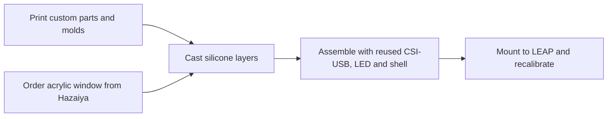

# 9DTact-HashimotoLab

**9DTact dimensional adjustments, robot mounts and fabrication handover.**<br>
9DTact 部品の寸法調整、ロボット用取り付け部品、製作と引き継ぎ。

**[BOM — materials, photos & STL downloads / 部品・材料・STL](bom/BOM_JP.md)**

This repository collects small dimensional adjustments to the original [9DTact](https://github.com/linchangyi1/9DTact) parts, robot-specific mounting adapters and Japan fabrication notes. Software and calibration remain upstream.

## Watch first / はじめに見る動画

[](https://www.youtube.com/watch?v=VxMceWVz7QQ)

Watch the original video, then follow the preparation and assembly steps below. / 元の動画を見てから、以下の準備・組み立て手順に進みます。

**Our CAD/STL parts:** download the lab's modified base, isolation ring and LEAP Hand adapter from the [BOM](bom/BOM_JP.md).<br>
**本研究室の CAD／STL：** 寸法調整したベース・遮光リングと LEAP Hand 用アダプターは、BOM からダウンロードしてください。

## Fabrication flow / 製作の流れ



## Prepare / 製作前の準備

1. **Print custom parts and molds.** Download the lab's STL files from the [BOM](bom/BOM_JP.md), check millimetre scale and dry-fit the camera PCB.<br>部品表の STL で本研究室の部品とモールドを造形し、mm 単位のスケールと基板の仮組みを確認します。
2. Prepare the acrylic-window drawing and order from [Hazaiya](docs/WINDOW_OUTSOURCING.md).<br>アクリル窓の図面を準備し、はざいやへ発注します。
3. Gather materials, tools and the reused **CSI–USB board, LED board and white shell** using the [BOM](bom/BOM_JP.md).<br>部品表の写真を見ながら、材料・工具と再利用する基板・シェルをそろえます。

| Item | Hashimoto Lab build / この実装 |
| --- | --- |
| **Camera** | Amazon JP **B0C5W1QF65**, with the existing CSI–USB board |
| **Layer 1 — transparent / 第1層・透明** | Clear 9345 silicone; Huizhou/QR-code bottles / 恵州ラベル・QRコードの容器 |
| **Layer 2 — translucent / 第2層・半透明** | Taobao **Shore 0A**, replacing 5A; bottles marked “0” / 「0」ラベルの容器 |
| **Layer 3 — black / 第3層・黒色** | Yellow/blue silicone jars + black pigment; links in the BOM / 黄色・青色の容器＋黒色顔料 |
| **Acrylic window / アクリル窓** | Outsource to **はざいや / Hazaiya** |
| **Casting molds / 注型モールド** | **3D print / 3D プリント** |
| **★ CSI–USB / LED / white shell** | **Reuse. Do not print the white shell in PLA. / 再利用。白色シェルは PLA 不可。** |

## Assembly / 組み立て

1. **Dry-fit the mechanics.** Check PCB seating, lens clearance, LED board, isolation ring, shell and screw engagement.<br>基板・レンズ・LED・遮光リング・シェルを仮組みし、隙間とねじの締結を確認します。
2. **Check camera and lighting.** Connect the reused boards, set exposure, gain and focus, and keep cables clear of clamping surfaces.<br>再利用する基板を接続し、露光・ゲイン・焦点を設定します。配線を挟まないように通します。
3. **Install the acrylic window.** Clean the optical faces and check the adhesive seal, bonding and fogging.<br>光学面を清掃し、窓の密封・接着・曇りを確認します。
4. **Cast layer 1.** Use the transparent silicone.<br>透明シリコーンで第1層を注型します。
5. **Cast and demold layer 2.** Use [Shore 0A](docs/MATERIALS.md). Release the mold–silicone interface with a utility knife instead of pressing or pulling the edge by hand.<br>[Shore 0A](docs/MATERIALS.ja.md) で第2層を注型します。指で端を押したり引いたりせず、カッターナイフでモールドとの界面を分離します。
6. **Cast and demold layer 3.** Add the specified black pigment to the third-layer silicone. Cover the contact surface and required sides; use the same knife-assisted release.<br>第3層のシリコーンに指定の黒色顔料を加え、接触面と必要な側面を遮光します。同じナイフ操作で脱型します。
7. **Mount to LEAP Hand.** Check screw engagement, joint travel, interference and cable slack.<br>LEAP Hand に取り付け、ねじの締結・可動域・干渉・ケーブルの余裕を確認します。

### Demolding layers 2 and 3 / 第2層・第3層の脱型


**Follow the mold–silicone seam; keep the sensing surface and black skin intact.** Remove hot-melt adhesive strips separately before release. [Detailed procedure](docs/DEMOLDING.md).<br>
**モールドとの接合面に沿って分離し、感圧面や黒色表皮を切らないようにします。** ホットメルト接着剤は先に別の工程として除去します。

## Calibration and verification / 校正・動作確認

Continue in the **[original 9DTact repository](https://github.com/linchangyi1/9DTact)** for calibration and verification. Follow its setup instructions and use its calibration, shape-reconstruction and force-estimation scripts.<br>
校正・動作確認は **元の 9DTact リポジトリ** の手順に従い、同リポジトリの環境構築手順と校正・形状復元・力推定スクリプトを使用してください。

## Credit and file licenses

**9DTact:** Changyi Lin, Han Zhang, Jikai Xu, Lei Wu and Huazhe Xu. [Project](https://linchangyi1.github.io/9DTact/) · [Paper](https://arxiv.org/abs/2308.14277) · [Original fabrication files](https://github.com/linchangyi1/9DTact/tree/main/9DTact_Design/fabrication).

**LEAP Hand:** Kenneth Shaw, Ananye Agarwal and Deepak Pathak. [Project](https://v1.leaphand.com/) · [Official CAD terms](https://v1.leaphand.com/cad_request).

Documentation, scripts and 9DTact-derived base/ring: **MIT**. LEAP fingertips: **upstream CAD terms**. [License details](LICENSE.md) · [Attribution](NOTICE.md) · [Sources](docs/SOURCES.md)

<details>
<summary>Repository layout and local checks</summary>

```text
hardware/cad/        Three SolidWorks source files
hardware/mesh/       Three important STL parts
hardware/manifest.json  Checksums, bounds and provenance
assets/parts/        Individual multi-view geometry sheets
assets/photos/      Material and LED photographs
bom/                Japanese sourcing and original Taobao cross-reference
docs/               Material notes, window outsourcing and build records
scripts/            Inventory checks, BOM rendering and STL preview rendering
```

```bash
python3 scripts/verify_repository.py
python3 scripts/render_bom.py --check
# Optional: regenerate geometry figures (numpy, Pillow)
python3 scripts/render_mesh_preview.py --animate
```

[Repository updates](docs/PUBLISHING.md) · [Remaining handover items](docs/KNOWN_GAPS.md)

</details>
