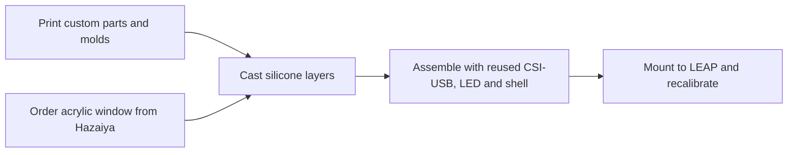

# 9DTact-HashimotoLab

**9DTact dimensional adjustments, robot mounts and fabrication handover.**<br>
9DTact 部品の寸法調整、ロボット用取り付け部品、製作と引き継ぎ。

**[BOM — materials, photos & STL downloads / 部品・材料・STL](bom/BOM_JP.md)**

This repository collects small dimensional adjustments to the original [9DTact](https://github.com/linchangyi1/9DTact) parts, robot-specific mounting adapters and Japan fabrication notes. Software and calibration remain upstream.

## Watch first / はじめに見る動画

[](https://www.youtube.com/watch?v=VxMceWVz7QQ)

**[▶ Watch on YouTube / YouTubeで再生](https://www.youtube.com/watch?v=VxMceWVz7QQ)**

Follow the original video for assembly. Our method for demolding layers 2 and 3 is shown below.<br>
組み立ては元の動画に沿って進めます。第2層・第3層の脱型には、以下の本研究室の方法を使います。

**Our CAD/STL parts:** download the lab's modified base, isolation ring and LEAP Hand adapter from the [BOM](bom/BOM_JP.md).<br>
**本研究室の CAD／STL：** 寸法調整したベース・遮光リングと LEAP Hand 用アダプターは、BOM からダウンロードしてください。

## Fabrication flow / 製作の流れ



## Prepare / 製作前の準備

1. **Print custom parts and molds.** Use the lab's STL files and the mold profiles linked in the [BOM](bom/BOM_JP.md). Use **lab PLA for all printed parts except the white shell**. Check millimetre scale and dry-fit the camera PCB.<br>部品表の専用 STL とモールド図面を使います。**白色シェル以外は研究室の PLA で造形**し、スケールと基板の仮組みを確認します。
2. Prepare the acrylic-window drawing and order from [Hazaiya](docs/WINDOW_OUTSOURCING.md).<br>アクリル窓の図面を準備し、はざいやへ発注します。
3. Gather materials, tools and the reused **CSI–USB board, LED board and white shell** using the [BOM](bom/BOM_JP.md).<br>部品表の写真を見ながら、材料・工具と再利用する基板・シェルをそろえます。

| Item | Hashimoto Lab build / この実装 |
| --- | --- |
| **Camera** | Amazon JP **B0C5W1QF65**, with the existing CSI–USB board |
| **Layer 1 — transparent / 第1層・透明** | 9345 silicone, approx. Shore 45; Japan stock not found / 硬度は約 Shore 45、日本の在庫は未発見 |
| **Layer 2 — translucent / 第2層・半透明** | **Ecoflex 00-30**, same as layer 3; untested substitute, expected to be close to Taobao Shore 0A / 未試験、Taobao Shore 0A に近い見込み |
| **Layer 3 — black / 第3層・黒色** | **Ecoflex 00-30** + black pigment; links in the BOM / Ecoflex 00-30 ＋黒色顔料 |
| **Acrylic window / アクリル窓** | Outsource to **はざいや / Hazaiya** |
| **Casting molds / 注型モールド** | **3D print / 3D プリント** |
| **★ CSI–USB / LED / white shell** | **Reuse. Outsourced white shell: White Nylon FS3300PA; no PLA. / 再利用。白色シェルの外注材は White Nylon FS3300PA、PLA 不可。** |

## Demolding layers 2 and 3 / 第2層・第3層の脱型

For **layer 2 (translucent)** and **layer 3 (black)**, use a utility knife to carefully release the **mold–silicone interface**, instead of pressing or pulling the silicone edge by hand as shown in the video.<br>
**第2層（半透明）・第3層（黒色）** は、動画のように指で端を押したり引いたりせず、カッターナイフで **モールドとシリコーンの界面** を慎重に分離します。


**Follow the mold–silicone seam; keep the sensing surface and black skin intact.** Remove hot-melt adhesive strips separately before release.<br>
**モールドとの接合面に沿って分離し、感圧面や黒色表皮を切らないようにします。** ホットメルト接着剤は先に別の工程として除去します。

## Calibration and verification / 校正・動作確認

Continue in the **[original 9DTact repository](https://github.com/linchangyi1/9DTact)** for calibration and verification. Follow its setup instructions and use its calibration, shape-reconstruction and force-estimation scripts.<br>
校正・動作確認は **元の 9DTact リポジトリ** の手順に従い、同リポジトリの環境構築手順と校正・形状復元・力推定スクリプトを使用してください。

## Credit and file licenses

**9DTact:** Changyi Lin, Han Zhang, Jikai Xu, Lei Wu and Huazhe Xu. [Project](https://linchangyi1.github.io/9DTact/) · [Paper](https://arxiv.org/abs/2308.14277) · [Original fabrication files](https://github.com/linchangyi1/9DTact/tree/main/9DTact_Design/fabrication).

**LEAP Hand:** Kenneth Shaw, Ananye Agarwal and Deepak Pathak. [Project](https://v1.leaphand.com/) · [Official CAD terms](https://v1.leaphand.com/cad_request).

Documentation, scripts and 9DTact-derived base/ring: **MIT**. LEAP fingertips: **upstream CAD terms**. [License details](LICENSE.md) · [Attribution](NOTICE.md) · [Sources](docs/SOURCES.md)

<details>
<summary>Repository layout and local checks</summary>

```text
hardware/cad/        Three SolidWorks source files
hardware/mesh/       Three important STL parts
hardware/manifest.json  Checksums, bounds and provenance
assets/parts/        Individual multi-view geometry sheets
assets/photos/      Material and LED photographs
bom/                Japanese sourcing and original Taobao cross-reference
docs/               Material notes, window outsourcing and build records
scripts/            Inventory checks, BOM rendering and STL preview rendering
```

```bash
python3 scripts/verify_repository.py
python3 scripts/render_bom.py --check
# Optional: regenerate geometry figures (numpy, Pillow)
python3 scripts/render_mesh_preview.py --animate
```

[Repository updates](docs/PUBLISHING.md) · [Remaining handover items](docs/KNOWN_GAPS.md)

</details>
