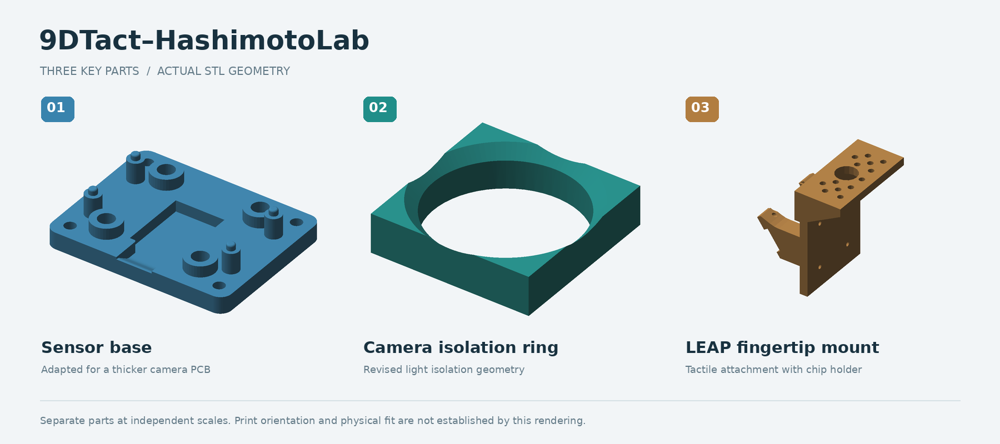
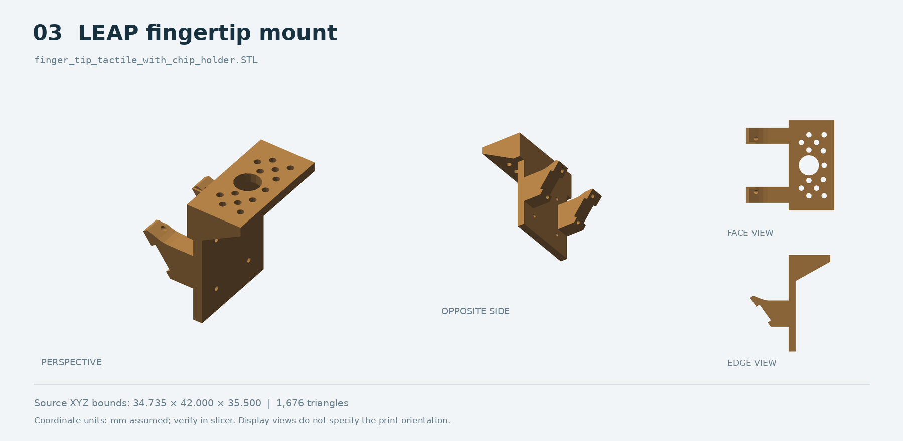

# 9DTact-HashimotoLab

**A visual hardware handover for 9DTact + LEAP Hand, fabricated in Japan.**<br>
9DTact の機構変更、LEAP Hand 取り付け部品、日本での製作と引き継ぎ。

[Handover · English](docs/HANDOVER.md) · [引き継ぎ · 日本語](docs/HANDOVER.ja.md) · [BOM](bom/BOM_JP.md) · [Materials · English](docs/MATERIALS.md) · [材料 · 日本語](docs/MATERIALS.ja.md) · [Hardware](hardware/README.md)



This build adapts [9DTact](https://github.com/linchangyi1/9DTact) for the lab's camera PCB and LEAP Hand mounting. This companion repository collects the modified parts, fabrication choices and Japan sourcing notes; software and calibration remain upstream.

## Three parts to know first / 重要な3つの部品

| Part | What changed / 用途・変更点 | Files |
| --- | --- | --- |
| **01 · Sensor base** | Adapted for a **thicker camera PCB** / 厚い基板に対応 | [STL](hardware/mesh/sensor_base_adapt_for_thick_PCB.STL) · [SolidWorks](hardware/cad/sensor_base_adapt_for_thick_PCB.SLDPRT) |
| **02 · Isolation ring** | Revised **camera light isolation** geometry / カメラ遮光リング | [STL](hardware/mesh/isolation_ring_out_11.4_in_10.3.STL) · [SolidWorks](hardware/cad/isolation_ring_out_11.4_in_10.3.SLDPRT) |
| **03 · LEAP fingertip mount** | Connects the tactile sensor to **LEAP Hand**, with a chip holder / チップホルダー付き | [STL](hardware/mesh/finger_tip_tactile_with_chip_holder.STL) · [SolidWorks variant](hardware/cad/finger_tip_tactile1_wrq.SLDPRT) |

### 01 · Sensor base / 厚い基板用のベース

The replacement base accommodates the builder's thicker camera PCB. Inspect the camera seat, fastener access and lens clearance before printing or assembling.

[](hardware/mesh/sensor_base_adapt_for_thick_PCB.STL)

**Use:** [sensor_base_adapt_for_thick_PCB.STL](hardware/mesh/sensor_base_adapt_for_thick_PCB.STL)<br>
**Edit:** [SolidWorks source](hardware/cad/sensor_base_adapt_for_thick_PCB.SLDPRT).

### 02 · Camera isolation ring / カメラ遮光リング

The revised ring is the light-isolation part around the camera optical path. Check its installed fit and the image near the sensing-area edges.

[](hardware/mesh/isolation_ring_out_11.4_in_10.3.STL)

**Use:** [isolation_ring_out_11.4_in_10.3.STL](hardware/mesh/isolation_ring_out_11.4_in_10.3.STL)<br>
**Edit:** [SolidWorks source](hardware/cad/isolation_ring_out_11.4_in_10.3.SLDPRT).

### 03 · LEAP fingertip mount / LEAP Hand 取り付け部品

Modified from official LEAP Hand fingertip CAD to hold the tactile sensor. The supplied STL includes a chip holder. Check joint travel, cable clearance and the mounting screws on the actual hand.

[](hardware/mesh/finger_tip_tactile_with_chip_holder.STL)

**Use:** [finger_tip_tactile_with_chip_holder.STL](hardware/mesh/finger_tip_tactile_with_chip_holder.STL)<br>
**Related editable variant:** [finger_tip_tactile1_wrq.SLDPRT](hardware/cad/finger_tip_tactile1_wrq.SLDPRT).

<details>
<summary><strong>360° rotating preview / 3つの部品を回転表示</strong></summary>


</details>

Check millimetre scale in the slicer. [Mesh dimensions and files →](hardware/README.md)

## Fabrication at a glance / 製作の流れ


| Item | Lab decision / 研究室での方針 | Go to |
| --- | --- | --- |
| **Camera** | **Amazon JP B0C5W1QF65**, with the existing CSI–USB board | [Camera product](https://www.amazon.co.jp/dp/B0C5W1QF65) |
| **Second silicone layer** | Taobao **Shore A 0**, replacing 5A | [English material notes](docs/MATERIALS.md) · [日本語](docs/MATERIALS.ja.md) |
| **Third-layer silicone** | Silicone for the black skin | [Amazon product](https://amzn.asia/d/08yFspH2) |
| **Third-layer pigment** | Black silicone pigment | [AliExpress product](https://ja.aliexpress.com/item/1005012698616201.html) |
| **Acrylic window** | Outsource **only the optical window** to **はざいや / Hazaiya** | [Vendor](https://www.hazaiya.co.jp/) · [Drawing / quotation guide](docs/WINDOW_OUTSOURCING.md) |
| **Casting molds** | **3D print the molds**; do not order the original acrylic mold plates | [Mold files / settings to add](docs/KNOWN_GAPS.md) |
| **★ CSI–USB converter** | **Reuse the existing board** | [BOM](bom/BOM_JP.md) |
| **★ LED board** | **Reuse existing assembly** | [BOM](bom/BOM_JP.md) |
| **★ White shell** | **Reuse existing shell — do not print in PLA** | [Handover](docs/HANDOVER.md) |

[Full BOM →](bom/BOM_JP.md)

## Demolding: a lab-specific change / 脱型方法の変更

After **layer 2 (translucent)** and **layer 3 (black)**, we use a **utility knife to carefully release the mold–silicone interface**, instead of pressing or pulling the silicone edge by hand as shown in the [assembly tutorial](https://www.youtube.com/watch?v=VxMceWVz7QQ).


**Follow the mold–silicone seam; keep the sensing surface intact.** [English / 日本語の手順 →](docs/DEMOLDING.md)

第2層と第3層では、指でシリコーンの端を押したり引いたりせず、カッターナイフでモールドとの界面を慎重に分離します。ホットメルト接着剤の除去は別の工程です。

## Material photographs / 材料の実物写真

The [BOM](bom/BOM_JP.md) includes photos of all three silicone pairs and the reused LED board. [Photo inventory / 写真一覧 →](assets/photos/README.md)

## Build and hand over / 引き継ぎの手順

1. Read the [English handover](docs/HANDOVER.md) or [日本語ガイド](docs/HANDOVER.ja.md); identify the reused CSI–USB board, LED board and white shell.
2. Download the **three STL parts**, confirm scale and dry-fit the camera. Obtain the lab's printed-mold files and settings.
3. Check the [Japan BOM](bom/BOM_JP.md), prepare the window drawing and test any replacement silicone in small samples.
4. Assemble, record the fabrication settings, test the LEAP mount through its intended motion, then recalibrate with [upstream 9DTact](https://github.com/linchangyi1/9DTact#3d-shape-reconstruction).

[Remaining handover items / 未完了項目 →](docs/KNOWN_GAPS.md)

## Credit and file licenses

**9DTact:** Changyi Lin, Han Zhang, Jikai Xu, Lei Wu and Huazhe Xu. [Project](https://linchangyi1.github.io/9DTact/) · [Paper](https://arxiv.org/abs/2308.14277) · [Original fabrication files](https://github.com/linchangyi1/9DTact/tree/main/9DTact_Design/fabrication).

**LEAP Hand:** Kenneth Shaw, Ananye Agarwal and Deepak Pathak. [Project](https://v1.leaphand.com/) · [Official CAD terms](https://v1.leaphand.com/cad_request).

Documentation, scripts and 9DTact-derived base/ring: **MIT**. LEAP fingertips: **upstream CAD terms**. [License details](LICENSE.md) · [Attribution](NOTICE.md) · [Sources](docs/SOURCES.md)

<details>
<summary>Repository layout and local checks</summary>

```text
hardware/cad/        Three SolidWorks source files
hardware/mesh/       Three important STL parts
hardware/manifest.json  Checksums, bounds and provenance
assets/parts/        Individual multi-view geometry sheets
assets/photos/      Material and LED photographs
bom/                Japanese sourcing and original Taobao cross-reference
docs/               Handover, materials, window outsourcing and build records
scripts/            Inventory checks, BOM rendering and STL preview rendering
```

```bash
python3 scripts/verify_repository.py
python3 scripts/render_bom.py --check
# Optional: regenerate geometry figures (numpy, Pillow)
python3 scripts/render_mesh_preview.py --animate
```

[Repository updates](docs/PUBLISHING.md)

</details>
