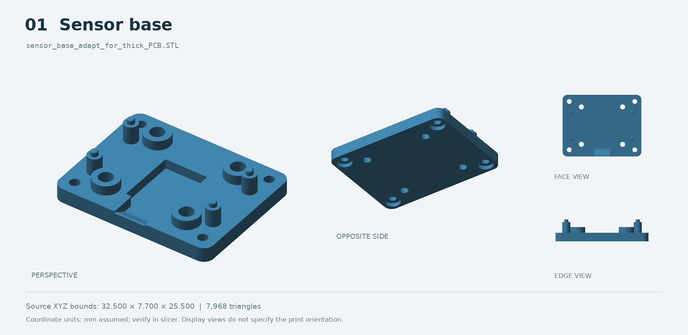
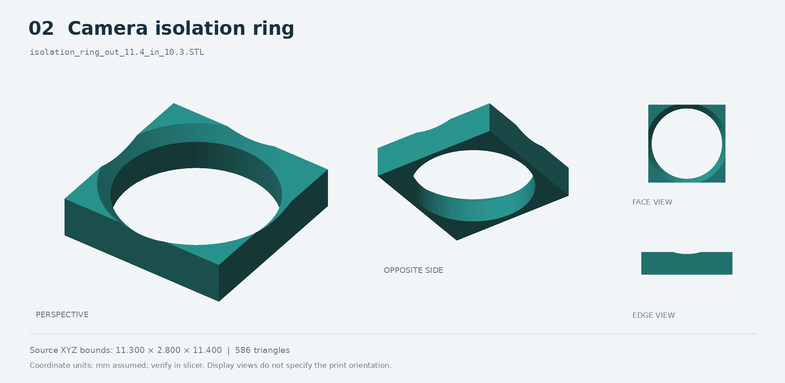
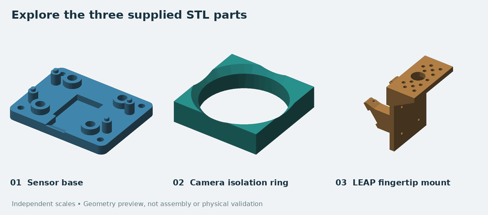
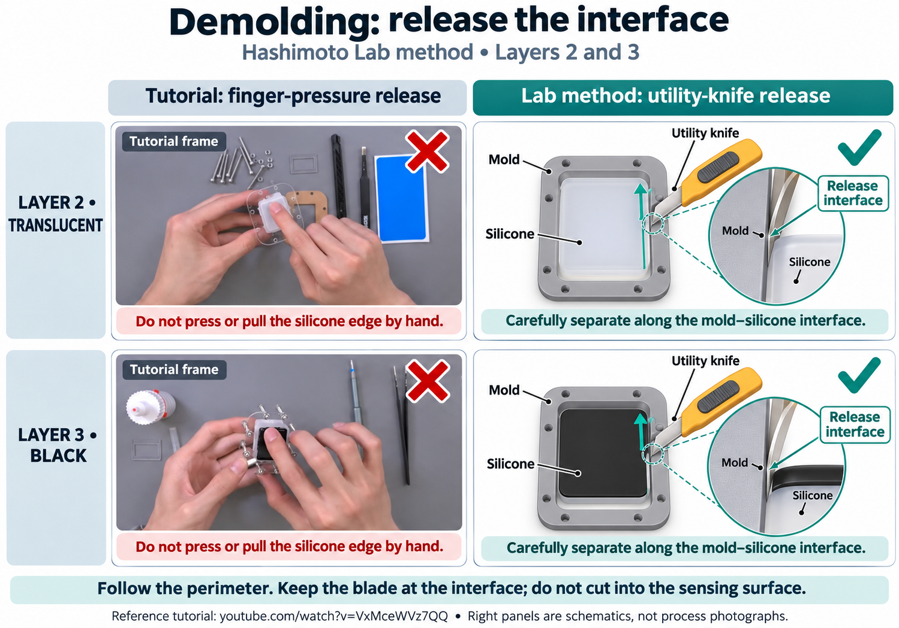

# 9DTact-HashimotoLab

**9DTact dimensional adjustments, robot mounts and fabrication handover.**<br>
9DTact 部品の寸法調整、ロボット用取り付け部品、製作と引き継ぎ。

**[Build guide / 製作ガイド](docs/HANDOVER.md)** · **[BOM](bom/BOM_JP.md)**

This repository collects small dimensional adjustments to the original [9DTact](https://github.com/linchangyi1/9DTact) parts, robot-specific mounting adapters and Japan fabrication notes. Software and calibration remain upstream.

## Watch first / はじめに見る動画

[](https://www.youtube.com/watch?v=VxMceWVz7QQ)

Watch the original video, then follow the **[Build guide](docs/HANDOVER.md)**. / 元の動画を見てから、製作ガイドに進みます。

## Three parts to know first / 重要な3つの部品

**01–02:** original 9DTact parts with small dimensional adjustments. **03:** an adapter for mounting 9DTact on LEAP Hand.<br>
**01・02：** 元の 9DTact 部品の寸法を微調整。**03：** 9DTact を LEAP Hand に取り付けるアダプター。


| Part | What changed / 用途・変更点 | Files |
| --- | --- | --- |
| **01 · 9DTact sensor base** | Original part; dimensions adjusted for the thicker PCB / 元部品の寸法を基板厚に合わせて調整 | [STL](hardware/mesh/sensor_base_adapt_for_thick_PCB.STL) · [SolidWorks](hardware/cad/sensor_base_adapt_for_thick_PCB.SLDPRT) |
| **02 · 9DTact isolation ring** | Original part; dimensions slightly adjusted / 元部品の寸法を微調整 | [STL](hardware/mesh/isolation_ring_out_11.4_in_10.3.STL) · [SolidWorks](hardware/cad/isolation_ring_out_11.4_in_10.3.SLDPRT) |
| **03 · LEAP Hand adapter** | Robot-specific mount with chip holder / LEAP Hand 用の連結部品、チップホルダー付き | [STL](hardware/mesh/finger_tip_tactile_with_chip_holder.STL) · [SolidWorks variant](hardware/cad/finger_tip_tactile1_wrq.SLDPRT) |

### 01 · 9DTact sensor base / ベースの寸法調整

The original 9DTact base with small dimensional adjustments to accommodate the lab's thicker camera PCB.

[](hardware/mesh/sensor_base_adapt_for_thick_PCB.STL)

**Use:** [sensor_base_adapt_for_thick_PCB.STL](hardware/mesh/sensor_base_adapt_for_thick_PCB.STL)<br>
**Edit:** [SolidWorks source](hardware/cad/sensor_base_adapt_for_thick_PCB.SLDPRT).

### 02 · 9DTact isolation ring / 遮光リングの寸法調整

The original 9DTact camera isolation ring with small dimensional adjustments for this build.

[](hardware/mesh/isolation_ring_out_11.4_in_10.3.STL)

**Use:** [isolation_ring_out_11.4_in_10.3.STL](hardware/mesh/isolation_ring_out_11.4_in_10.3.STL)<br>
**Edit:** [SolidWorks source](hardware/cad/isolation_ring_out_11.4_in_10.3.SLDPRT).

### 03 · LEAP Hand adapter / LEAP Hand 用連結部品

An adapter that connects 9DTact to LEAP Hand, modified from official LEAP Hand fingertip CAD. The supplied STL includes a chip holder.

[](hardware/mesh/finger_tip_tactile_with_chip_holder.STL)

**Use:** [finger_tip_tactile_with_chip_holder.STL](hardware/mesh/finger_tip_tactile_with_chip_holder.STL)<br>
**Related editable variant:** [finger_tip_tactile1_wrq.SLDPRT](hardware/cad/finger_tip_tactile1_wrq.SLDPRT).

**Planned:** a Robotiq mounting adapter. / **今後追加予定：** Robotiq 用の連結部品。

<details>
<summary><strong>360° rotating preview / 3つの部品を回転表示</strong></summary>



</details>

Check millimetre scale in the slicer. [Mesh dimensions and files →](hardware/README.md)

## Fabrication at a glance / 製作の流れ


| Item | Hashimoto Lab build / この実装 |
| --- | --- |
| **Camera** | Amazon JP **B0C5W1QF65**, with the existing CSI–USB board |
| **Second silicone layer** | Taobao **Shore A 0**, replacing 5A |
| **Third layer** | Specified silicone + black pigment; purchase links in the BOM |
| **Acrylic window** | Outsource the optical window to **はざいや / Hazaiya** |
| **Casting molds** | **3D print** |
| **★ CSI–USB / LED / white shell** | **Reuse existing parts. Do not print the white shell in PLA.** |

## Demolding: a lab-specific change / 脱型方法の変更

After **layer 2 (translucent)** and **layer 3 (black)**, we use a **utility knife to carefully release the mold–silicone interface**, instead of pressing or pulling the silicone edge by hand as shown in the [assembly tutorial](https://www.youtube.com/watch?v=VxMceWVz7QQ).



**Follow the mold–silicone seam; keep the sensing surface intact.** [English / 日本語の手順 →](docs/DEMOLDING.md)

第2層と第3層では、指でシリコーンの端を押したり引いたりせず、カッターナイフでモールドとの界面を慎重に分離します。ホットメルト接着剤の除去は別の工程です。

## Credit and file licenses

**9DTact:** Changyi Lin, Han Zhang, Jikai Xu, Lei Wu and Huazhe Xu. [Project](https://linchangyi1.github.io/9DTact/) · [Paper](https://arxiv.org/abs/2308.14277) · [Original fabrication files](https://github.com/linchangyi1/9DTact/tree/main/9DTact_Design/fabrication).

**LEAP Hand:** Kenneth Shaw, Ananye Agarwal and Deepak Pathak. [Project](https://v1.leaphand.com/) · [Official CAD terms](https://v1.leaphand.com/cad_request).

Documentation, scripts and 9DTact-derived base/ring: **MIT**. LEAP fingertips: **upstream CAD terms**. [License details](LICENSE.md) · [Attribution](NOTICE.md) · [Sources](docs/SOURCES.md)

<details>
<summary>Repository layout and local checks</summary>

```text
hardware/cad/        Three SolidWorks source files
hardware/mesh/       Three important STL parts
hardware/manifest.json  Checksums, bounds and provenance
assets/parts/        Individual multi-view geometry sheets
assets/photos/      Material and LED photographs
bom/                Japanese sourcing and original Taobao cross-reference
docs/               Handover, materials, window outsourcing and build records
scripts/            Inventory checks, BOM rendering and STL preview rendering
```

```bash
python3 scripts/verify_repository.py
python3 scripts/render_bom.py --check
# Optional: regenerate geometry figures (numpy, Pillow)
python3 scripts/render_mesh_preview.py --animate
```

[Repository updates](docs/PUBLISHING.md) · [Remaining handover items](docs/KNOWN_GAPS.md)

</details>
