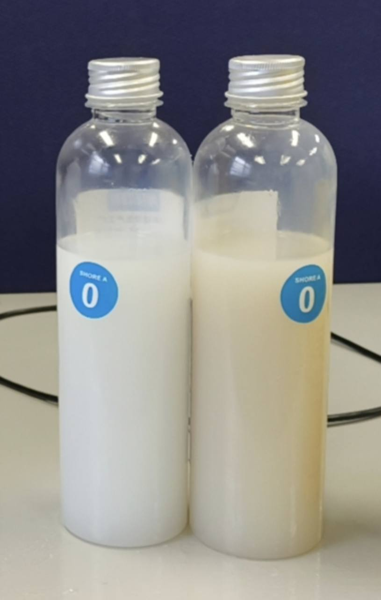
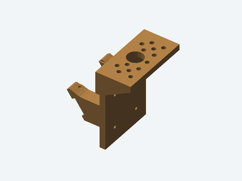

# Japan BOM and fabrication list

[Build guide / 製作手順](../README.md)

Parts, materials and shared tools for the Hashimoto Lab build. **★ Reuse existing lab parts.**

## Sensor components and materials

| ID / item | Photo / 写真 | Quantity | Specification | Source / file | Notes |
| --- | --- | --- | --- | --- | --- |
| **JP-01** Camera |  | 1 per sensor | Amazon Japan B0C5W1QF65. | [Amazon JP product: B0C5W1QF65](https://www.amazon.co.jp/dp/B0C5W1QF65) | **Purchased** Record the camera variant, PCB dimensions, lens and interface. |
| **JP-03** Clear acrylic camera window |  | 1 per sensor; spares as needed | Clear acrylic window, outsourced to Hazaiya. Original-design thickness: 2 mm. | [Hazaiya](https://www.hazaiya.co.jp/) [Drawing quotation](https://www.hazaiya.co.jp/index.php/estimate-drawing) [Outsourcing guide](../docs/WINDOW_OUTSOURCING.md) | **Fabricate** Set final thickness, outline and tolerances from the existing shell. |
| **JP-04** Layer 1: transparent silicone |  | Measure consumption per batch | Clear 9345 silicone from the original BOM. | [Amazon JP search](https://www.amazon.co.jp/s?k=9345+%E9%80%8F%E6%98%8E+%E3%82%B7%E3%83%AA%E3%82%B3%E3%83%BC%E3%83%B3+%E4%BB%98%E5%8A%A0%E5%9E%8B) [Japanese distributor catalog](https://sac-corp.co.jp/categories/additive_silicone.php) | **Search** Compare clarity, curing and interlayer adhesion when changing material. |
| **JP-05** Layer 2: translucent silicone, Shore 0 |  | Measure consumption per batch | Taobao item 649539121020, Shore A 0 option; replaces 5A. | [Amazon JP search](https://www.amazon.co.jp/s?k=Shore+0A+silicone+translucent) [SAC Ecoflex 00-30 candidate](https://sac-corp.myshopify.com/products/ecoflex-%EF%BD%B4%EF%BD%BA%EF%BE%8C%EF%BE%9A%EF%BD%AF%EF%BD%B8%EF%BD%BD-00-30-%EF%BE%84%EF%BE%97%EF%BD%B2%EF%BD%B1%EF%BE%99%EF%BD%B7%EF%BD%AF%EF%BE%84) [SAC Ecoflex 00-50 candidate](https://sac-corp.myshopify.com/products/ecoflex-00-50-%EF%BD%B4%EF%BD%BA%EF%BE%8C%EF%BE%9A%EF%BD%AF%EF%BD%B8%EF%BD%BD) [Japan A0 prototyping/material inquiry](https://ytc-eng.com/silicon_syurui) [Material research](../docs/MATERIALS.md) | **Candidate** Japan alternatives: see material notes for sample testing. |
| **JP-06** Layer 3: black-skin silicone |  | Measure consumption per batch | Silicone for the black skin; yellow/blue jars. | [Layer 3 silicone — Amazon](https://amzn.asia/d/08yFspH2) | **Selected** Record A/B ratio and curing conditions. |
| **JP-07** Black silicone pigment |  | Batch consumable | Black pigment for layer 3. | [Layer 3 pigment — AliExpress](https://ja.aliexpress.com/item/1005012698616201.html) | **Selected** Record pigment loading and check light blocking after curing. |
| **JP-08** M2 heat-set inserts |  | Original reference: 8; modified build TBC | M2 heat-set inserts; legacy designation M2-5-3. | [Amazon JP search](https://www.amazon.co.jp/s?k=M2+%E3%82%A4%E3%83%B3%E3%82%B5%E3%83%BC%E3%83%88%E3%83%8A%E3%83%83%E3%83%88+%E7%9C%9F%E9%8D%AE+5+3) | **Search** Match body length, outside diameter and insertion depth to CAD. |
| **JP-09** M2 base/shell screws |  | Original reference: 4; modified build TBC | M2 × 6 mm machine screws. | [Amazon JP search](https://www.amazon.co.jp/s?k=M2+6mm+%E5%B0%8F%E3%81%AD%E3%81%98+%E3%82%B9%E3%83%86%E3%83%B3%E3%83%AC%E3%82%B9) | **Search** Check head clearance and thread engagement. |
| **JP-10** M3 mold nuts |  | Original reference: 8 per set; printed molds TBC | M3 nuts for mold clamping. | [Amazon JP search](https://www.amazon.co.jp/s?k=M3+%E5%85%AD%E8%A7%92%E3%83%8A%E3%83%83%E3%83%88+%E3%82%B9%E3%83%86%E3%83%B3%E3%83%AC%E3%82%B9) | **Search** Adjust quantity to the printed mold. |
| **JP-11** M3 mold screws |  | Original reference: 8 per set; printed molds TBC | M3 × 30 mm mold screws from the original BOM. | [Amazon JP search](https://www.amazon.co.jp/s?k=M3+30mm+%E5%B0%8F%E3%81%AD%E3%81%98+%E3%83%8A%E3%83%83%E3%83%88) | **Search** Match clamping length and hole positions to the printed mold. |

## ★ Reused — skip procurement

| ID / item | Photo / 写真 | Quantity | Specification | Source / file | Notes |
| --- | --- | --- | --- | --- | --- |
| **JP-02** ★ Existing CSI-to-USB converter |  | 1 reused board per sensor | Existing camera-compatible CSI–USB board. | Reuse existing assembly | **Reuse** Keep its cables; record pinout and supply. |
| **JP-24** ★ Existing LED board and wiring |  | 1 reused assembly per sensor | Existing LED board and wiring. | Reuse existing assembly | **Reuse** Retain board orientation and supply connections. |
| **JP-25** ★ Existing white sensor shell |  | 1 reused shell per sensor | Existing white shell. **Do not print in PLA.** | Reuse existing assembly | **Reuse** Keep the existing optical shell. |

## Fabricated / printed parts

| ID / item | Photo / 写真 | Quantity | Specification | Source / file | Notes |
| --- | --- | --- | --- | --- | --- |
| **JP-26** Modified sensor base |  | 1 per sensor | Thicker-PCB sensor base; STL and SolidWorks. | [STL](../hardware/mesh/sensor_base_adapt_for_thick_PCB.STL) [SolidWorks source](../hardware/cad/sensor_base_adapt_for_thick_PCB.SLDPRT) | **Fabricate** Record print settings and camera-PCB fit. |
| **JP-27** Modified camera isolation ring |  | 1 per sensor | Revised camera isolation ring; STL and SolidWorks. | [STL](../hardware/mesh/isolation_ring_out_11.4_in_10.3.STL) [SolidWorks source](../hardware/cad/isolation_ring_out_11.4_in_10.3.SLDPRT) | **Fabricate** Check slicer scale and light isolation after assembly. |
| **JP-28** LEAP fingertip attachment |  | One per equipped finger | Chip-holder STL and editable SolidWorks fingertip variant. | [STL](../hardware/mesh/finger_tip_tactile_with_chip_holder.STL) [SolidWorks](../hardware/cad/finger_tip_tactile1_wrq.SLDPRT) | **Fabricate** Check screw engagement, cable clearance and joint travel. |
| **JP-29** 3D printed casting molds |  | 1 set per fabrication station | 3D printed casting molds. | [Missing fabrication information](../docs/KNOWN_GAPS.md) | **Fabricate** Mold files and print settings still to be added. |
| **JP-30** Calibration board |  | Shared; when calibrating | Upstream calibration_board design. | [Upstream fabrication](https://github.com/linchangyi1/9DTact/tree/main/9DTact_Design/fabrication) | **If needed** Recalibrate after material or mechanical changes. |

## Shared tools, consumables and optional items

| ID / item | Photo / 写真 | Quantity | Specification | Source / file | Notes |
| --- | --- | --- | --- | --- | --- |
| **JP-12** Electronic scale |  | 1 shared lab tool | Scale suitable for small silicone and pigment batches; 0.01 g display resolution. | [Amazon JP search](https://www.amazon.co.jp/s?k=%E3%83%87%E3%82%B8%E3%82%BF%E3%83%AB%E3%82%B9%E3%82%B1%E3%83%BC%E3%83%AB+0.01g+%E6%A0%A1%E6%AD%A3) | **Confirmed** Choose capacity for the batch size and calibrate before use. |
| **JP-13** Hot-glue gun |  | Shared, only if needed | Temporary fastening and wire retention. | [Amazon JP search](https://www.amazon.co.jp/s?k=goot+%E3%82%B0%E3%83%AB%E3%83%BC%E3%82%AC%E3%83%B3+AC100V) | **Confirmed** Keep hot glue out of the optical path. |
| **JP-14** Temperature-controlled soldering tools |  | Shared lab tool | HAKKO FX600-02, Japanese 100 V version. | [Amazon JP search](https://www.amazon.co.jp/s?k=HAKKO+FX600-02) [HAKKO manufacturer](https://www.hakko.com/japan/products/hakko_fx600.html) | **Confirmed** Use separate tips for soldering and insert installation. |
| **JP-15** Utility knife: demolding interface release / trimming |  | Shared lab tool | Release the mold–silicone interface after casting layers 2 and 3. | [Amazon JP search](https://www.amazon.co.jp/s?k=%E3%82%AB%E3%83%83%E3%82%BF%E3%83%BC%E3%83%8A%E3%82%A4%E3%83%95+%E7%B2%BE%E5%AF%86) [Demolding comparison and instructions](../docs/DEMOLDING.md) | **Confirmed** Follow the seam; keep the blade away from the sensing surface and black skin. |
| **JP-16** Mixing cups |  | Batch consumable | Clean silicone-compatible cups, such as PP. | [Amazon JP search](https://www.amazon.co.jp/s?k=PP+%E8%A8%88%E9%87%8F%E3%82%AB%E3%83%83%E3%83%97+%E4%BD%BF%E3%81%84%E6%8D%A8%E3%81%A6+%E6%A8%B9%E8%84%82) | **Confirmed** Leave headroom for expansion during degassing. |
| **JP-17** Mixing sticks |  | Batch consumable | Clean plastic mixing sticks. | [Amazon JP search](https://www.amazon.co.jp/s?k=%E3%83%97%E3%83%A9%E3%82%B9%E3%83%81%E3%83%83%E3%82%AF+%E6%94%AA%E6%8B%8C%E6%A3%92+%E3%82%B7%E3%83%AA%E3%82%B3%E3%83%B3) | **Confirmed** Keep mixing tools separate for each material. |
| **JP-18** Dust removal / low-lint cleaning supplies |  | Batch consumable | Low-lint wipes and adhesive dust-removal stickers. | [Amazon JP search](https://www.amazon.co.jp/s?k=%E3%83%AC%E3%83%B3%E3%82%BA+%E3%82%AF%E3%83%AA%E3%83%BC%E3%83%8B%E3%83%B3%E3%82%B0%E3%83%9A%E3%83%BC%E3%83%91%E3%83%BC+%E3%83%80%E3%82%B9%E3%83%88%E9%99%A4%E5%8E%BB+%E3%82%B7%E3%83%BC%E3%83%AB) | **Confirmed** Use stickers for dust pickup; use optical wipes for cleaning surfaces. |
| **JP-19** Plastic dispensing syringes |  | Batch consumable | Needle-free dispensing syringes. | [Amazon JP search](https://www.amazon.co.jp/s?k=%E6%A8%B9%E8%84%82+%E6%B3%A8%E5%85%A5+%E3%82%B7%E3%83%AA%E3%83%B3%E3%82%B8+%E9%87%9D%E3%81%AA%E3%81%97) | **Confirmed** Choose capacity and seal material for the silicone used. |
| **JP-20** Acrylic-window adhesive |  | Batch consumable | Clear adhesive compatible with PMMA and the white shell. | [Amazon JP search](https://www.amazon.co.jp/s?k=%E3%82%A2%E3%82%AF%E3%83%AA%E3%83%AB+%E3%83%8A%E3%82%A4%E3%83%AD%E3%83%B3+%E6%8E%A5%E7%9D%80%E5%89%A4+%E9%80%8F%E6%98%8E) | **Confirmed** Keep excess adhesive off the optical surfaces. |
| **JP-21** Black-layer bonding / repair adhesive |  | Only if required | Smooth-On Sil-Poxy for local silicone bonding or repair. | [Amazon JP search](https://www.amazon.co.jp/s?k=Smooth-On+Sil-Poxy) [SAC Sil-Poxy](https://sac-corp.myshopify.com/products/sil-poxy) [Japanese distributor technical data](https://sac-corp.co.jp/products/Sil-Poxy_TI.pdf) | **Confirmed** Apply only where bonding or repair is needed. |
| **JP-22** Vacuum degassing equipment |  | Shared lab equipment | Pump, vacuum-rated chamber and fittings; Japanese 100 V supply. | [Amazon JP search](https://www.amazon.co.jp/s?k=%E7%9C%9F%E7%A9%BA+%E8%84%B1%E6%B3%A1+%E3%83%81%E3%83%A3%E3%83%B3%E3%83%90%E3%83%BC+%E3%83%9D%E3%83%B3%E3%83%97+100V+%E3%82%B7%E3%83%AA%E3%82%B3%E3%83%B3) | **Confirmed** Size the chamber for batch volume and expansion during degassing. |
| **JP-23** Curing / heating equipment |  | Optional, shared | Heating equipment, if required by the silicone instructions. | [Amazon JP search](https://www.amazon.co.jp/s?k=%E6%81%92%E6%B8%A9%E5%99%A8+%E4%B9%BE%E7%87%A5%E5%99%A8+%E5%AE%9F%E9%A8%93%E7%94%A8+%E4%BD%8E%E6%B8%A9) | **Optional** Use the material-specific cure temperature and time. |
| **JP-31** Cable retention and strain relief |  | As required by actual LEAP routing | Small cable ties or suitable retainers. | [Amazon JP search](https://www.amazon.co.jp/s?k=%E7%B5%90%E6%9D%9F%E3%83%90%E3%83%B3%E3%83%89+%E5%B0%8F%E5%9E%8B+%E3%82%B1%E3%83%BC%E3%83%96%E3%83%AB+%E5%9B%BA%E5%AE%9A) | **Optional** Leave cable slack through the full joint travel. |

[Build record](../docs/BUILD_RECORD_TEMPLATE.md) · [Original Taobao references](TAOBAO_REFERENCE.md) · [Edit source data](bom_jp.json)
