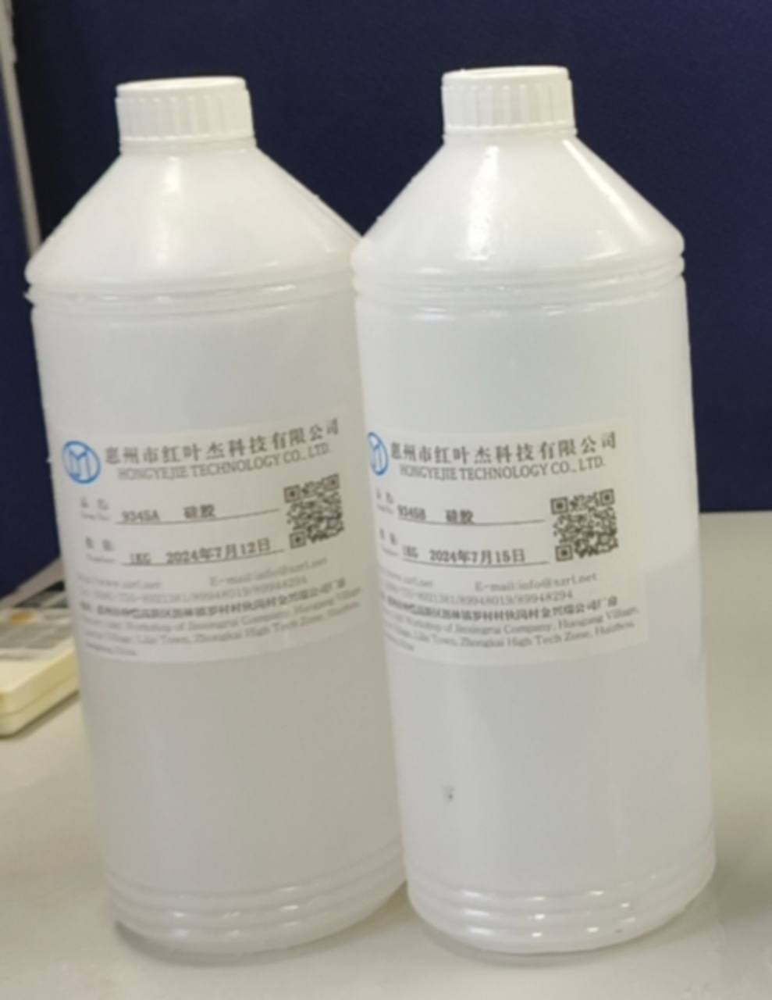
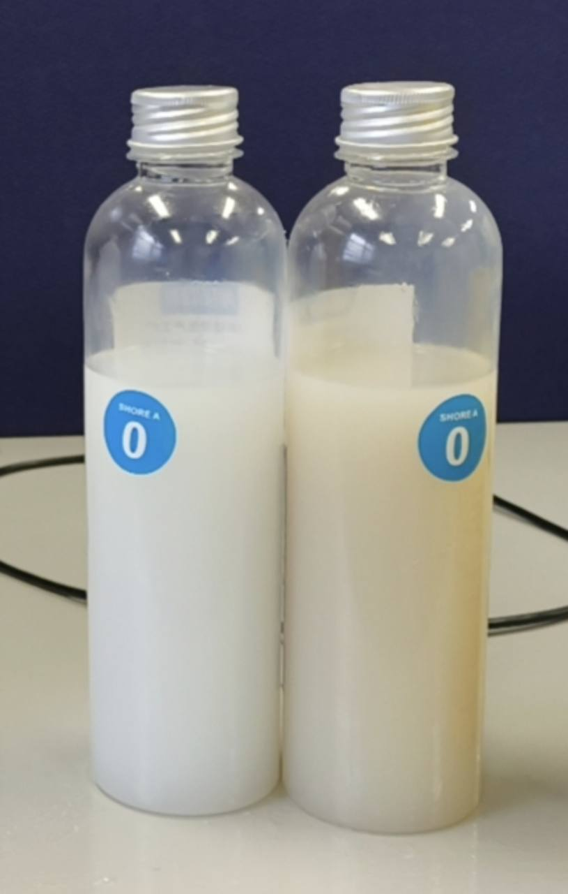
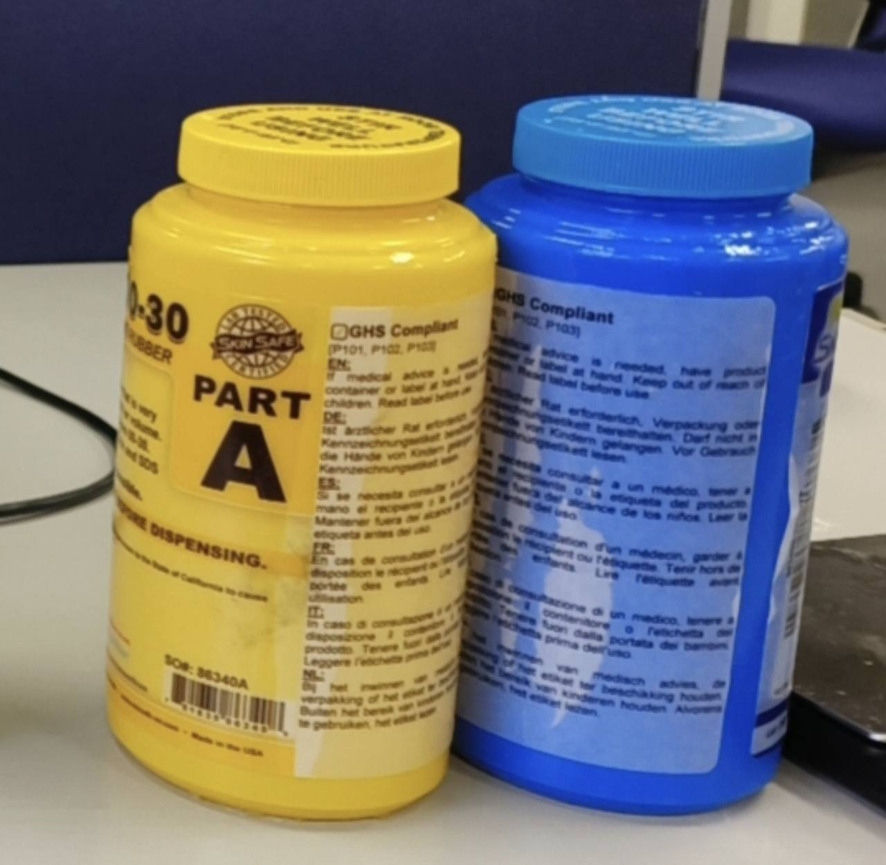
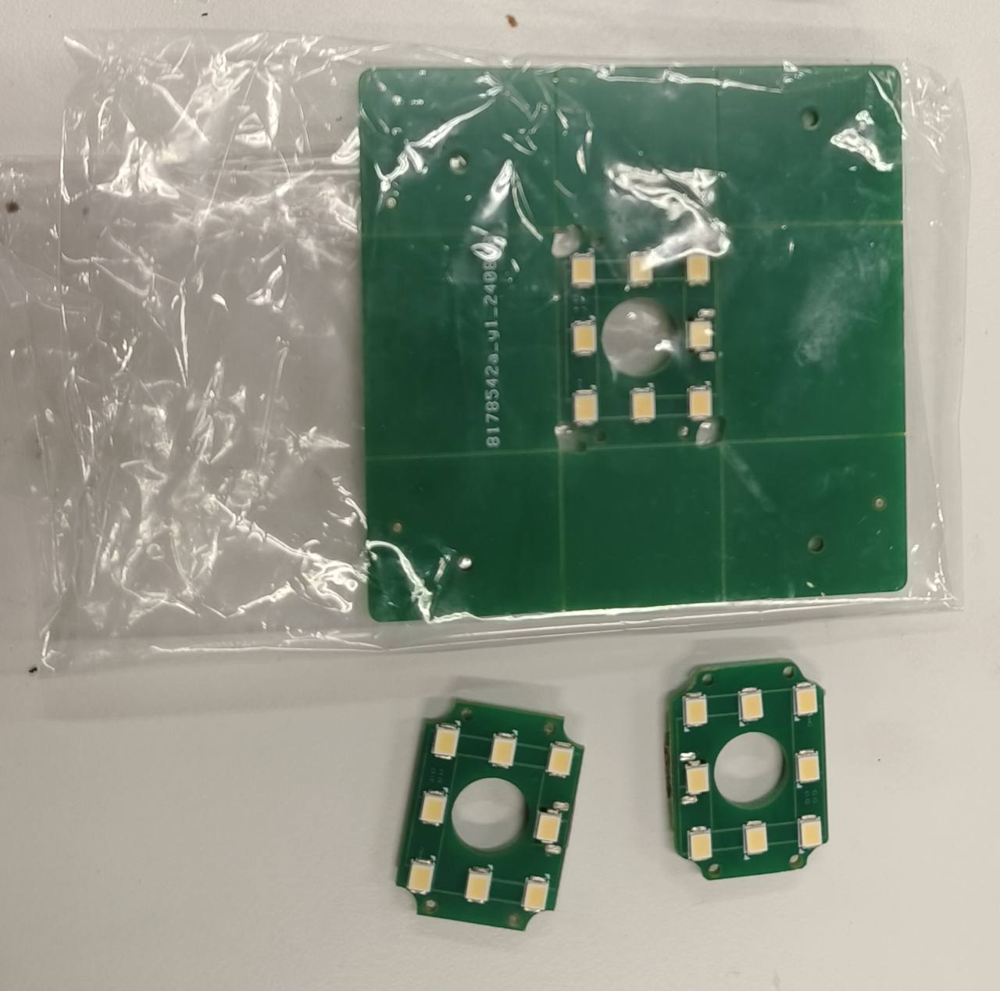
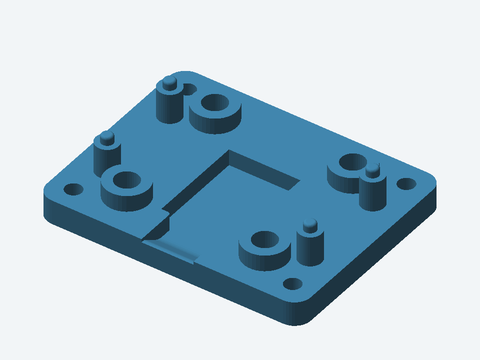
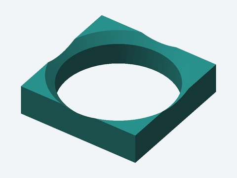
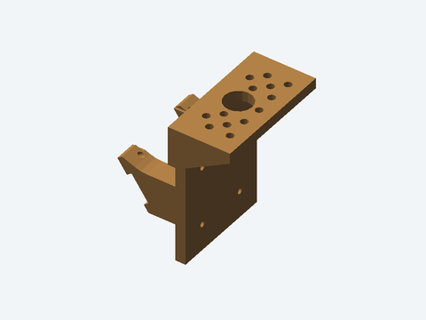

# 日本採購與製作表

[English BOM](BOM_JP.md) · **繁體中文**

Hashimoto Lab 的零件、材料與共用工具。

**CAD：Δ 修改原版零件 · ＋ 本實驗室新增零件。★ 沿用既有零件。**

[材料指南 · English](../docs/MATERIALS.md) · [材料 · 日本語](../docs/MATERIALS.ja.md)

## 感測器零件與材料

| ID | 項目／用途 | Photo / 写真 | 數量 | 規格 | 採購／檔案 | 備註 |
| --- | --- | --- | --- | --- | --- | --- |
| JP-01 | 相機 |  | 1／sensor | Amazon Japan B0C5W1QF65。 | [Amazon JP 商品：B0C5W1QF65](https://www.amazon.co.jp/dp/B0C5W1QF65) | **曾購買** 記錄相機變體、基板尺寸、鏡頭與介面。 |
| JP-03 | 透明壓克力 camera window |  | 1／sensor，備品另計 | 透明壓克力 window，送 Hazaiya 加工；原版厚度 2 mm。 | [はざいや](https://www.hazaiya.co.jp/) [圖面詢價](https://www.hazaiya.co.jp/index.php/estimate-drawing) [發包說明](../docs/WINDOW_OUTSOURCING.md) | **製作** 依既有外殼確定厚度、外形與公差。 |
| JP-04 | 第一層透明矽膠 |  | 依批次量測耗用量 | 原 BOM 的透明 9345 矽膠。 | [Amazon JP 搜尋](https://www.amazon.co.jp/s?k=9345+%E9%80%8F%E6%98%8E+%E3%82%B7%E3%83%AA%E3%82%B3%E3%83%BC%E3%83%B3+%E4%BB%98%E5%8A%A0%E5%9E%8B) [日本代理商材料目錄](https://sac-corp.co.jp/categories/additive_silicone.php) | **搜尋** 替換材料時比較透明度、固化與層間黏合。 |
| JP-05 | 第二層半透明矽膠：Shore 0A |  | 依批次量測耗用量 | 淘寶 item 649539121020 選 Shore 0A，取代原 5A。 | [Amazon JP 搜尋](https://www.amazon.co.jp/s?k=Shore+0A+silicone+translucent) [SAC Ecoflex 00-30 候選](https://sac-corp.myshopify.com/products/ecoflex-%EF%BD%B4%EF%BD%BA%EF%BE%8C%EF%BE%9A%EF%BD%AF%EF%BD%B8%EF%BD%BD-00-30-%EF%BE%84%EF%BE%97%EF%BD%B2%EF%BD%B1%EF%BE%99%EF%BD%B7%EF%BD%AF%EF%BE%84) [SAC Ecoflex 00-50 候選](https://sac-corp.myshopify.com/products/ecoflex-00-50-%EF%BD%B4%EF%BD%BA%EF%BE%8C%EF%BE%9A%EF%BD%AF%EF%BD%B8%EF%BD%BD) [日本 Shore 0A 試作／材料詢問](https://ytc-eng.com/silicon_syurui) [材料研究](../docs/MATERIALS.md) | **候選** 日本替代候選與小樣測試見材料指南。 |
| JP-06 | 第三層黑色表皮用矽膠 |  | 依批次量測耗用量 | 黑色表皮用矽膠，黃藍兩罐。 | [第三層矽膠：Amazon](https://amzn.asia/d/08yFspH2) | **指定品** 記錄 A/B 配比與固化條件。 |
| JP-07 | 黑色矽膠顏料 |  | 批次耗材 | 第三層黑色顏料。 | [第三層顏料：AliExpress](https://ja.aliexpress.com/item/1005012698616201.html) | **指定品** 記錄添加量，固化後檢查遮光。 |
| JP-08 | M2 熱熔嵌件 |  | 原版參考 8；修改版待核對 | M2 熱熔銅螺母；原規格 M2-5-3。 | [Amazon JP 搜尋](https://www.amazon.co.jp/s?k=M2+%E3%82%A4%E3%83%B3%E3%82%B5%E3%83%BC%E3%83%88%E3%83%8A%E3%83%83%E3%83%88+%E7%9C%9F%E9%8D%AE+5+3) | **搜尋** 依 CAD 核對長度、外徑與埋入深度。 |
| JP-09 | 底座／外殼 M2 螺絲 |  | 原版參考 4；修改版待核對 | M2 × 6 mm 機械螺絲。 | [Amazon JP 搜尋](https://www.amazon.co.jp/s?k=M2+6mm+%E5%B0%8F%E3%81%AD%E3%81%98+%E3%82%B9%E3%83%86%E3%83%B3%E3%83%AC%E3%82%B9) | **搜尋** 確認頭部空間與鎖入長度。 |
| JP-10 | 模具 M3 螺帽 |  | 原版參考 8／套；列印模具待核對 | 模具固定用 M3 螺帽。 | [Amazon JP 搜尋](https://www.amazon.co.jp/s?k=M3+%E5%85%AD%E8%A7%92%E3%83%8A%E3%83%83%E3%83%88+%E3%82%B9%E3%83%86%E3%83%B3%E3%83%AC%E3%82%B9) | **搜尋** 數量依列印模具調整。 |
| JP-11 | 模具 M3 螺絲 |  | 原版參考 8／套；列印模具待核對 | 原 BOM 的 M3 × 30 mm 模具螺絲。 | [Amazon JP 搜尋](https://www.amazon.co.jp/s?k=M3+30mm+%E5%B0%8F%E3%81%AD%E3%81%98+%E3%83%8A%E3%83%83%E3%83%88) | **搜尋** 依列印模具核對夾持長度與孔位。 |

## ★ 沿用，跳過採購

| ID | 項目／用途 | Photo / 写真 | 數量 | 規格 | 採購／檔案 | 備註 |
| --- | --- | --- | --- | --- | --- | --- |
| JP-02 | ★ 既有 CSI → USB 轉接板 |  | 1／sensor，沿用現有零件 | 既有相機用 CSI–USB 轉接板。 | 待補 | **沿用** 保留線材，記錄腳位與供電。 |
| JP-24 | ★ LED 板／既有線路 |  | 1／sensor，來自既有零件 | 既有 LED 板與線路。 | 待補 | **沿用** 保留安裝方向與供電接線。 |
| JP-25 | ★ 白色 sensor shell |  | 1／sensor，來自既有零件 | 既有白色外殼，**不可用 PLA 列印。** | 待補 | **沿用** 沿用現有光學外殼。 |

## 自行製作／加工件

| ID | 項目／用途 | Photo / 写真 | 數量 | 規格 | 採購／檔案 | 備註 |
| --- | --- | --- | --- | --- | --- | --- |
| JP-26 | Δ 修改版底座 |  | 1／sensor | 厚基板用 sensor base；STL 與 SolidWorks。 | [STL](../hardware/mesh/sensor_base_adapt_for_thick_PCB.STL) [SolidWorks source](../hardware/cad/sensor_base_adapt_for_thick_PCB.SLDPRT) | **製作** 記錄列印參數與相機基板配合。 |
| JP-27 | Δ 修改版 camera isolation ring |  | 1／sensor | 修改版相機遮光環；STL 與 SolidWorks。 | [STL](../hardware/mesh/isolation_ring_out_11.4_in_10.3.STL) [SolidWorks source](../hardware/cad/isolation_ring_out_11.4_in_10.3.SLDPRT) | **製作** 確認切片比例與組裝後遮光。 |
| JP-28 | ＋ LEAP fingertip 固定件 |  | 依裝設手指數量 | 帶晶片座 STL 與可編輯 SolidWorks 指尖變體。 | [STL](../hardware/mesh/finger_tip_tactile_with_chip_holder.STL) [SolidWorks](../hardware/cad/finger_tip_tactile1_wrq.SLDPRT) | **製作** 確認螺絲鎖入、配線空間與關節可動域。 |
| JP-29 | 3D 列印 casting molds |  | 1 套／製作工位 | 3D 列印注型模具。 | [製作缺口](../docs/KNOWN_GAPS.md) | **製作** 待補模具檔案與列印參數。 |
| JP-30 | Calibration board |  | 校正時使用／共用 | 上游 calibration_board 設計。 | [上游 fabrication](https://github.com/linchangyi1/9DTact/tree/main/9DTact_Design/fabrication) | **視需求** 材料或機構更改後重新校正。 |

## 共用工具、耗材與選配

| ID | 項目／用途 | Photo / 写真 | 數量 | 規格 | 採購／檔案 | 備註 |
| --- | --- | --- | --- | --- | --- | --- |
| JP-12 | 電子秤 |  | 實驗室共用 1 台 | 適合小批量矽膠與顏料的電子秤，顯示解析度 0.01 g。 | [Amazon JP 搜尋](https://www.amazon.co.jp/s?k=%E3%83%87%E3%82%B8%E3%82%BF%E3%83%AB%E3%82%B9%E3%82%B1%E3%83%BC%E3%83%AB+0.01g+%E6%A0%A1%E6%AD%A3) | **已確認** 依批量選量程，使用前校正。 |
| JP-13 | 熱熔膠槍 |  | 有需求才使用／共用 | 臨時固定與線材固定用。 | [Amazon JP 搜尋](https://www.amazon.co.jp/s?k=goot+%E3%82%B0%E3%83%AB%E3%83%BC%E3%82%AC%E3%83%B3+AC100V) | **已確認** 熱熔膠避開光路。 |
| JP-14 | 溫控烙鐵／工具 |  | 實驗室共用 | HAKKO FX600-02，日本 100 V 版本。 | [Amazon JP 搜尋](https://www.amazon.co.jp/s?k=HAKKO+FX600-02) [HAKKO 原廠](https://www.hakko.com/japan/products/hakko_fx600.html) | **已確認** 焊接與熱熔螺母使用不同烙鐵頭。 |
| JP-15 | 美工刀：脫模界面分離／修邊 |  | 實驗室共用 | 第二、三層脫模時分離模具與矽膠界面。 | [Amazon JP 搜尋](https://www.amazon.co.jp/s?k=%E3%82%AB%E3%83%83%E3%82%BF%E3%83%BC%E3%83%8A%E3%82%A4%E3%83%95+%E7%B2%BE%E5%AF%86) [脫模對照與說明](../docs/DEMOLDING.md) | **已確認** 沿接縫操作，避免切到感測面與黑色表皮。 |
| JP-16 | 混合杯 |  | 每批耗材 | 乾淨且與矽膠相容的容器，例如 PP。 | [Amazon JP 搜尋](https://www.amazon.co.jp/s?k=PP+%E8%A8%88%E9%87%8F%E3%82%AB%E3%83%83%E3%83%97+%E4%BD%BF%E3%81%84%E6%8D%A8%E3%81%A6+%E6%A8%B9%E8%84%82) | **已確認** 保留脫泡膨脹空間。 |
| JP-17 | 攪拌棒 |  | 每批耗材 | 乾淨的塑膠攪拌棒。 | [Amazon JP 搜尋](https://www.amazon.co.jp/s?k=%E3%83%97%E3%83%A9%E3%82%B9%E3%83%81%E3%83%83%E3%82%AF+%E6%94%AA%E6%8B%8C%E6%A3%92+%E3%82%B7%E3%83%AA%E3%82%B3%E3%83%B3) | **已確認** 不同材料分開使用攪拌工具。 |
| JP-18 | 除塵／低掉屑清潔耗材 |  | 批次耗材 | 低棉絮擦拭紙與除塵貼。 | [Amazon JP 搜尋](https://www.amazon.co.jp/s?k=%E3%83%AC%E3%83%B3%E3%82%BA+%E3%82%AF%E3%83%AA%E3%83%BC%E3%83%8B%E3%83%B3%E3%82%B0%E3%83%9A%E3%83%BC%E3%83%91%E3%83%BC+%E3%83%80%E3%82%B9%E3%83%88%E9%99%A4%E5%8E%BB+%E3%82%B7%E3%83%BC%E3%83%AB) | **已確認** 除塵貼黏取灰塵，光學擦拭紙清潔表面。 |
| JP-19 | 塑膠針筒 |  | 每批耗材 | 無針頭分裝針筒。 | [Amazon JP 搜尋](https://www.amazon.co.jp/s?k=%E6%A8%B9%E8%84%82+%E6%B3%A8%E5%85%A5+%E3%82%B7%E3%83%AA%E3%83%B3%E3%82%B8+%E9%87%9D%E3%81%AA%E3%81%97) | **已確認** 容量與密封材質需適合使用的矽膠。 |
| JP-20 | Window 接著劑 |  | 批次耗材 | 相容於 PMMA 與白色外殼的透明接著劑。 | [Amazon JP 搜尋](https://www.amazon.co.jp/s?k=%E3%82%A2%E3%82%AF%E3%83%AA%E3%83%AB+%E3%83%8A%E3%82%A4%E3%83%AD%E3%83%B3+%E6%8E%A5%E7%9D%80%E5%89%A4+%E9%80%8F%E6%98%8E) | **已確認** 避免溢膠沾到光學面。 |
| JP-21 | 黑色層黏合／修補膠 |  | 有需要才使用 | Smooth-On Sil-Poxy，局部矽膠黏合與修補用。 | [Amazon JP 搜尋](https://www.amazon.co.jp/s?k=Smooth-On+Sil-Poxy) [SAC Sil-Poxy](https://sac-corp.myshopify.com/products/sil-poxy) [日本代理商技術資料](https://sac-corp.co.jp/products/Sil-Poxy_TI.pdf) | **已確認** 僅用於需黏合或修補的位置。 |
| JP-22 | 真空脫泡設備 |  | 實驗室共用 | 真空幫浦、真空容器與接頭；日本 100 V 電源。 | [Amazon JP 搜尋](https://www.amazon.co.jp/s?k=%E7%9C%9F%E7%A9%BA+%E8%84%B1%E6%B3%A1+%E3%83%81%E3%83%A3%E3%83%B3%E3%83%90%E3%83%BC+%E3%83%9D%E3%83%B3%E3%83%97+100V+%E3%82%B7%E3%83%AA%E3%82%B3%E3%83%B3) | **已確認** 依批量與脫泡膨脹空間選容器。 |
| JP-23 | 固化加熱設備 |  | 選配／共用 | 依矽膠使用說明選用加熱設備。 | [Amazon JP 搜尋](https://www.amazon.co.jp/s?k=%E6%81%92%E6%B8%A9%E5%99%A8+%E4%B9%BE%E7%87%A5%E5%99%A8+%E5%AE%9F%E9%A8%93%E7%94%A8+%E4%BD%8E%E6%B8%A9) | **選用** 使用該材料的固化溫度與時間。 |
| JP-31 | 線材固定與拉力釋放 |  | 依 LEAP 布線 | 小型束帶或合適的固定件。 | [Amazon JP 搜尋](https://www.amazon.co.jp/s?k=%E7%B5%90%E6%9D%9F%E3%83%90%E3%83%B3%E3%83%89+%E5%B0%8F%E5%9E%8B+%E3%82%B1%E3%83%BC%E3%83%96%E3%83%AB+%E5%9B%BA%E5%AE%9A) | **選用** 保留關節全可動域所需的線材餘量。 |

[製作紀錄](../docs/BUILD_RECORD_TEMPLATE.md) · [原始淘寶對照](TAOBAO_REFERENCE.md) · [編輯資料來源](bom_jp.json)
