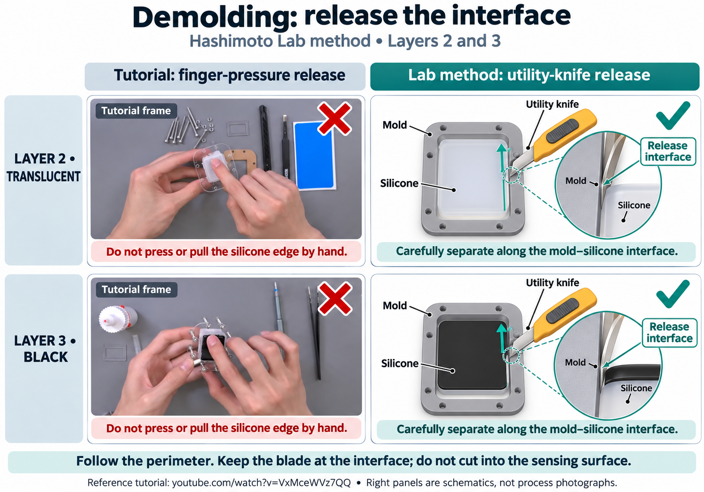

# Demolding layers 2 and 3 / 第二、三層脫模

**Hashimoto Lab method: carefully separate the mold–silicone interface with a utility knife.**

This applies after casting the **second, translucent silicone layer** and again when demolding the **third, black silicone layer**. The builder specifies this change from the finger-pressure release shown in the [assembly tutorial](https://www.youtube.com/watch?v=VxMceWVz7QQ).

The red X identifies the method **not used in this lab build**; it is not a general assessment of the original tutorial. Right-hand panels are explanatory schematics, not photographs or exact drawings of the lab's printed molds. The seam is enlarged to show where the blade goes.

## English instructions

| Stage | Original tutorial action shown | Hashimoto Lab procedure |
| --- | --- | --- |
| **Layer 2 — translucent** | Press the silicone edge with a finger to open a gap | Use a utility knife to carefully release the silicone from the mold along their interface |
| **Layer 3 — black** | Press the black silicone edge with a finger to open a gap | Use the same utility-knife interface-release method; preserve the black skin and sensing surface |

1. Finish curing according to the actual silicone recipe. Complete the required mold-fastener or adhesive-strip removal for that mold assembly.
2. **Do not press or pull the silicone edge by hand to initiate separation.**
3. Support the mold and carefully guide the utility-knife blade along the **outer mold–silicone interface**, working around the perimeter to release the adhesion.
4. Keep the blade at that interface. **Do not cut through the silicone pad, across the sensing surface, or into the black skin.** No specific blade depth or angle has been documented for this build.
5. Lift away the mold once the interface has released. If an edge is still attached, release that location rather than pulling the silicone by hand.

The tutorial's removal of **hot-melt adhesive strips** is a separate operation. The crossed-out comparison refers to finger-pressure release of the silicone from the mold, not to the adhesive-strip removal step.

Record the knife used, mold version and any edge/surface damage in the [build record](BUILD_RECORD_TEMPLATE.md). See **JP-15** in the [English BOM](../bom/BOM_JP.md) for the tool entry. The actual knife model and detailed mold geometry have not yet been supplied.

## 繁體中文說明

第二層半透明矽膠完成後脫模，以及第三層黑色矽膠完成後脫模，都採用同一個修改：**不用手指把矽膠邊緣壓開或拉開，改用美工刀沿模具與矽膠的交界小心分離。**

- 先依實際配方完成固化，並處理該模具需要移除的螺絲／固定膠條。
- 固定住模具，刀尖沿外圍的「模具—矽膠界面」逐段分離黏著處。
- **不是把矽膠本體切開，也不是在感測接觸面或黑色表皮上劃一刀。** 實驗室尚未提供固定刀深或刀角，不在示意圖中虛構數值。
- 確認周邊已釋放後再取下模具；若仍黏住，回到該處分離，不用手硬拉矽膠。

第三張參考截圖中的「移除熱熔膠條」是另一個步驟；此處紅叉只針對用手壓開矽膠邊緣的做法。

## Figure provenance

The left panels use the builder-supplied tutorial screenshots for the translucent and black demolding stages, with comparison marks. The original [YouTube tutorial](https://www.youtube.com/watch?v=VxMceWVz7QQ) remains the assembly reference. Direct video playback was unavailable during preparation; this note is grounded in the supplied frames, their visible captions, and the builder's explicit procedure description. No video timestamps are claimed.

The right-hand knife diagrams were generated with the built-in image-generation tool and reviewed to distinguish interface release from cutting the sensing surface. The [generation prompt](../assets/process/demolding-comparison.prompt.txt) is retained for revision. Real process photographs can be added later.
