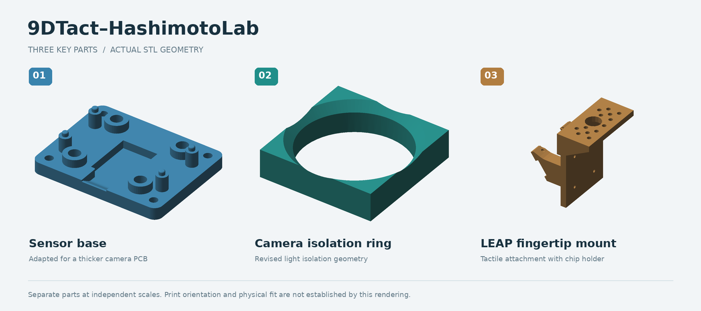

# Hardware inventory / 硬體檔案

All five files are byte-for-byte copies of the supplied handover inputs: three important STL parts and two SolidWorks source files. See [manifest.json](manifest.json) for SHA-256 values, provenance, and mesh measurements.

| File | Purpose | Format / readiness |
| --- | --- | --- |
| [sensor_base_adapt_for_thick_PCB.STL](mesh/sensor_base_adapt_for_thick_PCB.STL) | **01 ·** Revised 9DTact base for thicker camera PCB | Supplied printable mesh; confirm scale, print settings and fit |
| [sensor_base_adapt_for_thick_PCB.SLDPRT](cad/sensor_base_adapt_for_thick_PCB.SLDPRT) | Editable source for the base design | SolidWorks source; **STEP still needed**; source configuration/export correspondence not inspected |
| [isolation_ring_out_11.4_in_10.3.STL](mesh/isolation_ring_out_11.4_in_10.3.STL) | Revised camera isolation ring | Supplied mesh; slicer scale, print settings and fit need confirmation |
| [finger_tip_tactile_with_chip_holder.STL](mesh/finger_tip_tactile_with_chip_holder.STL) | LEAP fingertip attachment with chip holder | Supplied mesh, derived from official LEAP CAD |
| [finger_tip_tactile1_wrq.SLDPRT](cad/finger_tip_tactile1_wrq.SLDPRT) | LEAP fingertip attachment source variant | Editable SolidWorks source, derived from official LEAP CAD; **not verified as the source of the chip-holder STL** |

## Geometry inspection

| Mesh | Triangles | Coordinate extents X × Y × Z |
| --- | ---: | --- |
| Sensor base | 7,968 | 32.500 × 7.700 × 25.500 |
| Isolation ring | 586 | 11.300 × 2.800 × 11.400 |
| Chip-holder fingertip | 1,676 | 34.735 × 42.000 × 35.500 |

STL does not encode units. These are measured numerical mesh bounds, provisionally treated as mm for handover; they are **not** measured inner/outer diameters, tolerances or assembly clearances. The ring's filename should not be used as a verified dimensional drawing. Mesh inspection checks binary structure and finite coordinates; no physical printing or fit validation was performed here.

## Exporting for fabrication

The three supplied STL files can be opened directly in a slicer after verifying scale. For editable exchange, open each `.SLDPRT` in a compatible SolidWorks installation, confirm the active configuration and units, and export STEP. For any new STL export, record the configuration, export tolerance and source checksum, then compare bounds and important features. Do not simply rename a source extension to `.STL` or assume the two fingertip variants match.

Individual geometry sheets: [base](../assets/parts/sensor-base.png) · [ring](../assets/parts/isolation-ring.png) · [LEAP mount](../assets/parts/leap-fingertip.png). [Rotating preview](../assets/parts-turntable.gif). The display rotation only changes the view; source files remain unchanged.

Base, ring and mount print materials, layer heights, supports and orientation are not in the supplied notes. Record the lab's successful settings before publishing a validated recipe. **The white optical shell cannot be printed in PLA and is reused in this revision.**

## Molds and acrylic window

- **Molds:** 3D printed in this build; actual files are missing from this handover. Upstream acrylic DXF profiles may help recover geometry but are not ready-to-print mold volumes.
- **Window:** transparent acrylic, outsourced to Hazaiya; final production drawing is still needed. See [window outsourcing](../docs/WINDOW_OUTSOURCING.zh-TW.md).
- **★ LED board / ★ white shell:** reuse existing assemblies; sourcing and new fabrication are deliberately deferred.
- **Calibration board:** obtain the original file from [upstream fabrication](https://github.com/linchangyi1/9DTact/tree/main/9DTact_Design/fabrication) if recalibration is required.

## Upstream mapping

The revised base replaces upstream `fabrication/sensor_base.*`; the revised ring replaces upstream `fabrication/isolation_ring.*`. LEAP attachments are additions to the tactile sensor build. Upstream CAD and meshes have not been bundled or mechanically compared against this revision. The browsing reference was upstream `main` on 2026-11-18; a commit hash has not yet been recorded. See [sources](../docs/SOURCES.md) and [license scope](../LICENSE.md).
